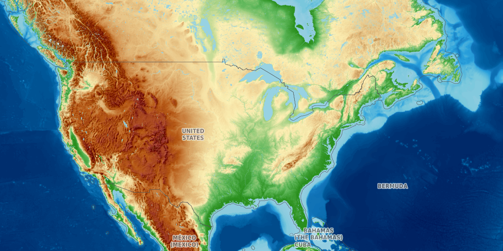
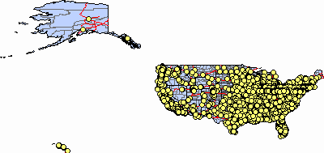
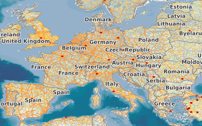
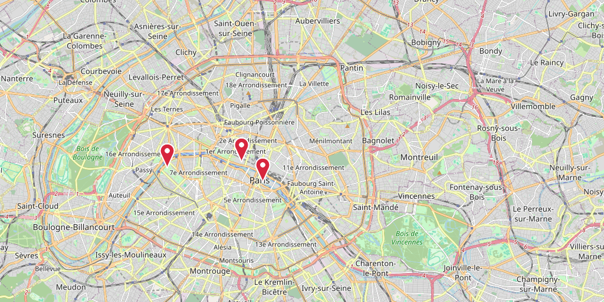

<h1>inline-maps</h1>

This Claude Code plugin gets a map image from a map service URL.
It shows the map image in the terminal, in the Claude Code transcript.

<h2>Terms</h2>

This document uses each term for one concept only.

<dl>
  <dt>Plugin</dt>
  <dd>Code that Claude Code loads at session start. Claude Code calls this type of plugin a "mod". The plugin API is early access.</dd>
  <dt>Hook</dt>
  <dd>A function that the plugin attaches to one Claude Code event, for example <code>tool.call</code> or <code>ui.render</code>.</dd>
  <dt>Tool</dt>
  <dd><code>show_map</code>. The model calls the tool when you ask for a map.</dd>
  <dt>Command</dt>
  <dd><code>/map</code>. You type the command at the prompt.</dd>
  <dt>Map service</dt>
  <dd>A server that makes map images: ArcGIS REST, OGC WMS, OGC API - Maps, or an XYZ tile server.</dd>
  <dt>Tile</dt>
  <dd>One 256 × 256 px PNG in a Web Mercator grid, addressed by zoom <code>z</code>, column <code>x</code> and row <code>y</code>.</dd>
  <dt>Marker</dt>
  <dd>A red pin that the plugin draws on the map image at one point, given as <code>marker=lon,lat[,label]</code>.</dd>
  <dt>Bounding box</dt>
  <dd><code>bbox=minx,miny,maxx,maxy</code>, in degrees, EPSG:4326.</dd>
  <dt>Terminal</dt>
  <dd>A terminal that supports the kitty graphics protocol: Ghostty, kitty, or tmux with passthrough.</dd>
</dl>

<h2>Supported map services</h2>

The plugin reads the URL. It identifies the type of map service.
It then makes one request for a map image, or one request for each tile.
The plugin tests the patterns in the order of the table.

<table>
  <thead>
    <tr><th>Map service</th><th>URL pattern</th><th>Request</th><th>Example URL</th></tr>
  </thead>
  <tbody>
    <tr><td>XYZ / WMTS RESTful tiles</td><td><code>{z}</code> or <code>{TileMatrix}</code></td><td>Up to 4 × 4 tiles</td><td><code>https://tile.opentopomap.org/{z}/{x}/{y}.png</code></td></tr>
    <tr><td>ArcGIS MapServer</td><td><code>…/MapServer</code></td><td><code>export</code>, PNG32</td><td><code>https://sampleserver6.arcgisonline.com/arcgis/rest/services/USA/MapServer</code></td></tr>
    <tr><td>ArcGIS ImageServer</td><td><code>…/ImageServer</code></td><td><code>exportImage</code>, PNG</td><td></td></tr>
    <tr><td>OGC API - Maps</td><td><code>…/collections/…</code> or <code>…/map</code></td><td><code>…/map?f=png</code></td><td><code>https://example.org/api/collections/roads</code></td></tr>
    <tr><td>OGC WMS 1.1.1 / 1.3.0</td><td><code>service=wms</code> or <code>/wms</code></td><td><code>GetCapabilities</code>, then <code>GetMap</code></td><td><code>https://ows.terrestris.de/osm/service</code></td></tr>
  </tbody>
</table>

If no pattern matches, the plugin tries WMS first. If WMS fails, it tries OGC API - Maps.

<table>
  <tr>
    <td valign="top" width="50%">
       
      ArcGIS MapServer <code>export</code>. No bounding box, so the plugin uses the full extent of the map service. 560 × 425 px.
    </td>
    <td valign="top" width="50%">
       
      OGC WMS 1.3.0 <code>GetMap</code>, layer <code>OSM-WMS</code>, <code>bbox=-10,35,30,60</code>. 560 × 518 px.
    </td>
  </tr>
</table>

<h2>How it works</h2>

<code>show()</code> in <code>hooks/register.tsx</code> does these steps for the tool and for the command.

<ol>
  <li><b>Plan.</b> <code>plan()</code> in <code>hooks/maps.ts</code> identifies the map service. It reads service metadata as text, for example <code>?f=json</code> or <code>GetCapabilities</code>. It returns one map image URL, or a list of tile URLs. It has no host API calls, so the tests give it fixed responses.</li>
  <li><b>Size.</b> <code>plan()</code> sets the map image size from the ground distance, not from the degrees. One degree of longitude is shorter than one degree of latitude, by the cosine of the latitude.</li>
  <li><b>Download.</b> <code>curl</code> gets each URL into one temporary directory per Claude Code process. The plugin uses <code>curl</code> because <code>$.http.fetch</code> returns text only.</li>
  <li><b>Check.</b> The plugin accepts a body only if the HTTP status is 2xx and the bytes are a PNG.</li>
  <li><b>Stitch.</b> For tiles, <code>magick montage</code> joins the tiles into one PNG. The plugin then deletes the tile files.</li>
  <li><b>Pin.</b> If you give a marker, <code>markerPixel()</code> converts the point to a pixel of the map image. <code>magick -draw</code> draws the pin. The label goes in the caption.</li>
  <li><b>Cache.</b> The plugin keeps the last 12 map images in memory as base64. It keeps the bytes only if the map image is 2 MiB or less.</li>
  <li><b>Draw.</b> A <code>ui.render</code> hook replaces the transcript row with an image, a caption and a file link. If the cache has no bytes, the terminal reads the file from its path.</li>
</ol>

<blockquote>

<b>NOTE:</b> ArcGIS keeps square pixels. For an extent in degrees, the plugin requests <code>imageSR=3857</code> (Web Mercator). WMS and OGC API - Maps stretch the map image to the requested size. For these, the plugin multiplies the width by the cosine of the middle latitude.

</blockquote>

<blockquote>

<b>NOTE:</b> WMS 1.3.0 uses latitude, longitude axis order for EPSG:4326. WMS 1.1.1 uses longitude, latitude. The plugin swaps the bounding box for 1.3.0.

</blockquote>

<h2>Tool and command</h2>

The tool and the command use the same <code>show()</code> function. They return the result in different ways.

<table>
  <thead>
    <tr><th></th><th>Tool <code>show_map</code></th><th>Command <code>/map</code></th></tr>
  </thead>
  <tbody>
    <tr><td>Started by</td><td>The model</td><td>You</td></tr>
    <tr><td>Result</td><td>JSON string: <code>{width, height, path, caption, source}</code></td><td>Text: <code>&lt;source&gt;: &lt;caption&gt; · &lt;w&gt;×&lt;h&gt;</code>, then the path</td></tr>
    <tr><td>Draw hook</td><td><code>ui.render</code> on <code>ToolResult</code></td><td><code>ui.render</code> on <code>CommandOutput</code></td></tr>
    <tr><td>Error</td><td>Tool error (<code>{ deny }</code>)</td><td>Text: <code>map failed: …</code></td></tr>
  </tbody>
</table>

<blockquote>

<b>CAUTION:</b> The <code>CommandOutput</code> hook parses the command text with a regular expression. If you change the text format of <code>/map</code>, change the expression too. If you do not, the command shows text only.

</blockquote>

<h2>Install</h2>

You need Claude Code 2.1.287 or later, and <code>curl</code>. For tiles, you also need ImageMagick (<code>magick</code>).

<ol>
  <li>Add the marketplace:
    <pre><code>claude plugin marketplace add mraad/claude-inline-maps</code></pre>
  </li>
  <li>Install the plugin:
    <pre><code>claude plugin install inline-maps@claude-inline-maps</code></pre>
  </li>
  <li>Start a new Claude Code session in a supported terminal.</li>
</ol>

To install the plugin for one project only, do the two commands from the project folder. Add <code>--scope project</code> to each command. Claude Code writes the settings to <code>.claude/settings.json</code>.

<h2>Terminals</h2>

<table>
  <thead>
    <tr><th>Terminal</th><th>Result</th></tr>
  </thead>
  <tbody>
    <tr><td>Ghostty</td><td>Map image</td></tr>
    <tr><td>kitty</td><td>Map image</td></tr>
    <tr><td>tmux with passthrough</td><td>Map image</td></tr>
    <tr><td>tmux without passthrough</td><td>Caption and file path</td></tr>
    <tr><td>Other terminals</td><td>Caption and file path</td></tr>
  </tbody>
</table>

The plugin draws the map image with the kitty graphics protocol. If the terminal does not support it, you get the caption and the file path.

For tmux, add these lines to <code>~/.tmux.conf</code>. Then restart tmux:

<pre><code>set -g allow-passthrough on
set -g focus-events on</code></pre>

<h2>Update</h2>

<ol>
  <li>Get the new marketplace data:
    <pre><code>claude plugin marketplace update claude-inline-maps</code></pre>
  </li>
  <li>Update the plugin:
    <pre><code>claude plugin update inline-maps@claude-inline-maps</code></pre>
  </li>
  <li>Restart Claude Code.</li>
</ol>

<h2>Use</h2>

<h3>With the command</h3>

<ol>
  <li>Type the command and the map service URL:
    <pre><code>/map https://ows.terrestris.de/osm/service bbox=-10,35,30,60 width=600</code></pre>
  </li>
  <li>Push Enter.</li>
  <li>Look at the output row. It shows the map image, the caption and the file path.</li>
</ol>

<h3>With the tool</h3>

<ol>
  <li>Ask Claude for the map:
    <pre><code>show me https://tile.openstreetmap.org/{z}/{x}/{y}.png over the US</code></pre>
  </li>
  <li>Look at the tool result row. It shows the map image.</li>
</ol>

<h3>With a marker</h3>

<ol>
  <li>Add the marker option to the command:
    <pre><code>/map https://tile.openstreetmap.org/{z}/{x}/{y}.png bbox=2.22,48.81,2.47,48.91 marker=2.2945,48.8584,Eiffel Tower</code></pre>
  </li>
  <li>Push Enter.</li>
  <li>Look at the map image. The pin tip is on the point. The caption ends with the label.</li>
</ol>

You can also ask Claude: <code>show a map of Paris and place a marker on the Eiffel Tower</code>.

<h3>Options</h3>

<table>
  <thead>
    <tr><th>Option</th><th>Value</th><th>If you do not give it</th></tr>
  </thead>
  <tbody>
    <tr><td><code>bbox</code></td><td><code>minx,miny,maxx,maxy</code> in degrees</td><td>The extent of the map service. For tiles, the world.</td></tr>
    <tr><td><code>layers</code></td><td>WMS layer names, or ArcGIS layer ids (sent as <code>show:&lt;ids&gt;</code>)</td><td>The first named WMS layer. All ArcGIS layers.</td></tr>
    <tr><td><code>width</code></td><td>Pixels, 64 to 2000</td><td>800. Tiles ignore this option.</td></tr>
    <tr><td><code>marker</code></td><td><code>lon,lat</code> or <code>lon,lat,label</code> in degrees. The plugin draws a red pin at the point. The label goes in the caption.</td><td>No pin.</td></tr>
  </tbody>
</table>

<h2>Limits</h2>

<ul>
  <li>The plugin draws PNG only. A JPEG tile server, for example Esri World Street Map tiles, gives an error.</li>
  <li>The plugin sends no tokens. A map service that needs authentication gives an error.</li>
  <li>Tiles are Web Mercator, 256 px, and whole. The map image covers the bounding box. The plugin does not crop it.</li>
  <li>The plugin does not read WMTS capabilities documents. Give the RESTful tile template.</li>
  <li>Each download stops at 4 MiB or 20 s.</li>
  <li>A map image larger than 2 MiB draws from its file path. The terminal must read the file itself, so SSH and tmux do not show it.</li>
  <li>The plugin draws in the terminal only. The desktop app, VS Code and mobile show text.</li>
  <li>The plugin saves each map image as <code>map-N.png</code>. Nothing deletes the temporary directories. They collect in <code>$TMPDIR</code> across sessions.</li>
  <li>A tile server can send an error tile with HTTP status 200. The plugin cannot detect this.</li>
  <li>The plugin draws a marker only inside the map image. For OGC API - Maps, and for an ArcGIS map service with a projected extent other than Web Mercator, give a bounding box with the marker.</li>
</ul>

<blockquote>

<b>NOTE:</b> The plugin sends the User-Agent <code>inline-maps (+https://github.com/mraad/claude-inline-maps)</code>. OpenStreetMap blocks the default <code>curl</code> User-Agent.

</blockquote>

<h2>Develop and test</h2>

The plugin has no build step. Claude Code loads <code>hooks/register.tsx</code>, as <code>hooks/hooks.json</code> specifies.

<pre><code>claude plugin validate .   # check manifest and hooks
claude plugin test .       # run hooks/*.test.ts(x)
claude --plugin-dir .      # start a session with this folder loaded</code></pre>

<ul>
  <li><code>hooks/maps.test.ts</code> tests <code>plan()</code> for each map service type, with fixed responses. It also tests marker parsing, the marker pixel for each projection, and the marker errors.</li>
  <li><code>hooks/register.test.tsx</code> renders the <code>/map</code> output row and looks for the image element.</li>
  <li>The test environment has no network and no file system. The tests do not cover <code>curl</code>, <code>magick</code> or the terminal output.</li>
</ul>

The plugin API is early access. A Claude Code release can change it. The plugin was tested with Claude Code 2.1.312.

<a href="docs/index.html"><code>docs/index.html</code></a> has the same content as a styled page, with a data-flow diagram.

<h2>Contribute</h2>

Only the author can push to <code>main</code> or merge into it. A ruleset on <code>main</code> enforces this.

<ol>
  <li>Fork the repository.</li>
  <li>Make a branch in your fork.</li>
  <li>Make your change.</li>
  <li>Run <code>claude plugin validate .</code>.</li>
  <li>Run <code>claude plugin test .</code>.</li>
  <li>Open a pull request to <code>main</code>.</li>
</ol>

The author reviews the pull request and merges it.

<h2>License</h2>

MIT

